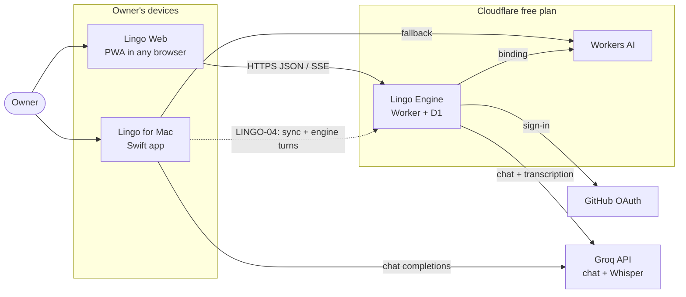
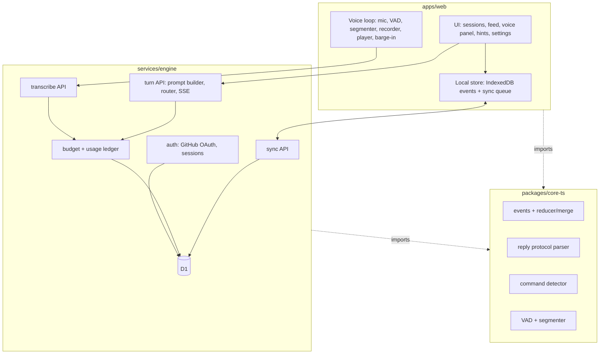

# Lingo — Architecture

Status: **target architecture, accepted direction** (owner brainstorms of 2026-10-26) · Version 5 · Date: 2026-11-03
Supersedes: the architecture sections of `docs/changes/LINGO-03/*` v1 drafts and the "engine" wording of the audit reports.
Decision records: [ADR-0001](../decisions/ADR-0001-stack.md) (Mac stack), [ADR-0002](../decisions/ADR-0002-web-stack.md) (web stack),
[ADR-0003](../decisions/ADR-0003-authentication.md) (sign-in), [ADR-0004](../decisions/ADR-0004-repository-layout.md) (monorepo and contracts),
[ADR-0005](../decisions/ADR-0005-model-routing-and-quota.md) (model routing, quota pools, Groq keys).

This document describes **what Lingo is made of, how the parts talk, and why**. Requirements live in the change specs
(`docs/changes/LINGO-NN/spec.md`); this file never defines requirements, it explains structure.

| Document | Scope |
|---|---|
| **ARCHITECTURE.md** (this file) | the whole system and everything shared by both apps |
| [MAC.md](MAC.md) | **Lingo for Mac** — modules, files, data on disk, commands, where to change what |
| [WEB.md](WEB.md) | **Lingo Web + Lingo Engine** — every other device (iPhone, iPad, Android, Windows, any browser) |
| [CODEBASE.md](CODEBASE.md) | repository map, shared contracts, scripts |
| [EVOLVING.md](../process/EVOLVING.md) | how to update and extend the apps within this architecture (invariants, recipes, ADRs) |

---

## 1. Product in one paragraph

Lingo is a personal voice tutor for practising **spoken English and German**, with explanations in **Russian only on request**.
One owner (GitHub `itmax04`) practises **4 sessions × 30 minutes per day** (2 German + 2 English) on a **Mac** and on a **phone**
(iPhone Air, iPhone 11), an **iPad**, an **Android** phone, a **Windows** PC and other people's computers. Everything runs on **free tiers**.
The assistant speaks, listens, can be interrupted, follows commands ("repeat", "slower", "how do I say …", "explain"),
corrects mistakes in the chosen mode (as we go / after the session / on request), never rates pronunciation,
and keeps the history so a session can continue on any device. Later it becomes a **teacher**: memory about the learner,
spaced repetition of their mistakes and words, scenarios (life in Germany, work, German B1 Goethe/telc, English IELTS-style speaking),
progress and weekly reports.

## 2. System context



| Element | Responsibility | Not responsible for |
|---|---|---|
| **Lingo for Mac** (`apps/mac`) | Standalone voice app: on-device recognition (whisper.cpp), on-device speech synthesis, its own model chain with keys in the Keychain, its own journal. Works without the engine. | Serving other devices; storing audio |
| **Lingo Web** (`apps/web`) | PWA client: microphone, utterance detection, recording, playback with device voices, UI, local copy of the history (IndexedDB), sync queue | Prompts, model calls, keys, budgets (all on the engine) |
| **Lingo Engine** (`services/engine`) | The web's "brain" and the account: sign-in, history store and sync, prompt building, model routing and quota, transcription proxy, usage ledger, later the teacher features | Audio storage; anything the Mac does locally |
| **Contracts** (`packages/contracts`) | The single source of truth shared by Swift and TypeScript: event schema, API schema, prompt snapshots, eval sets, golden fixtures | Runtime code |
| Groq | Chat models (gpt-oss-120b, gpt-oss-20b, qwen) and Whisper large-v3-turbo | — |
| Workers AI | Fallback chat model and fallback transcription through the Worker binding | — |
| GitHub OAuth | Proves "this is itmax04" for the web sign-in | Authorization beyond identity (the engine allow-lists the user id) |

### 2.1 What exists today (2026-10-28)

| Element | State |
|---|---|
| Lingo for Mac | **working** (LINGO-01 MVP); redesign LINGO-07 in PR #33; Stage 0 stabilisation next |
| Contracts | event schema v1, OpenAPI, golden fixtures — **written**; prompts and evals move in P-01 |
| Lingo Engine, Lingo Web, core-ts | **not written yet** — LINGO-03 Stages 1–2; design references ready in `design/redesign-2026` |
| Mac ↔ account, native iPhone | planned — LINGO-04, LINGO-06 |
| Teacher on the Mac | built in LINGO-05 (T-1…T-9); see [MAC.md](MAC.md) |

## 3. Containers and code layout

Target layout (ADR-0004). The move of the Swift package into `apps/mac` is plan step **P-01** of LINGO-03;
until it lands the Swift package is at the repository root.

```
apps/
  mac/                 Swift package: LingoCore, LingoMac (app "Lingo"), LingoEvalKit, lingo-eval, tests, scripts for the Mac
  web/                 React + TypeScript + Vite PWA
services/
  engine/              Cloudflare Worker (TypeScript): API, auth, D1 migrations, model router, prompts
packages/
  contracts/           event schema, OpenAPI, prompt snapshots, eval sets, golden fixtures — language-neutral
  core-ts/             TypeScript ports shared by web and engine: event types, merge/reducer, ULID, reply-protocol parser,
                       command detector, VAD + utterance segmenter
docs/                  architecture, decisions (ADR), changes (SDLC per change), process, reference
scripts/               repository-wide scripts (secret scan, language check, CI helpers)
.github/               CI workflows, PR template
```



## 4. Logic placement (who decides what)

| Concern | Mac | Web client | Engine |
|---|---|---|---|
| Session state machine (listening → thinking → speaking), barge-in, local "repeat"/"slower" | ✔ (Swift `TurnController`) | ✔ (TS) | — |
| Speech recognition | on device (whisper.cpp) | — (records, uploads) | ✔ Groq Whisper, Workers AI fallback |
| Speech synthesis | ✔ AVSpeechSynthesizer | ✔ `speechSynthesis` | — |
| Prompt building, context window, summary | ✔ (Swift `PromptBuilder`, `ContextPolicy`) | — | ✔ (TS port, **same snapshots**) |
| Model routing, fallback, quota, usage ledger | ✔ (own chain, own keys) | — | ✔ (pools, budgets) |
| History of record | own journal (+ engine from LINGO-04) | IndexedDB copy | ✔ D1 |
| Teacher features (memory, spaced repetition, plans, reports) — LINGO-05 | ✔ local on the Mac (shipped; own journal and chain) | planned (shared contracts, D-01) | planned |

**Rule:** the model proposes content; code decides state. Saving an utterance, switching language, cancelling a reply,
ending a session and writing results are done by application code, never by the model (pattern confirmed by Speak's published architecture).

**Parity rule:** where the same behaviour exists in Swift and TypeScript (prompts, reply parsing, commands, VAD/segmenter, merge),
both implementations are tested against the **same fixtures in `packages/contracts`**. A behaviour change updates the fixture first,
then both implementations. CI fails when either side diverges.

## 5. The voice turn

### 5.1 Web turn (phone, tablet, any browser)

```mermaid
sequenceDiagram
  autonumber
  participant U as Learner
  participant W as Web client
  participant E as Engine
  participant G as Groq
  U->>W: speaks
  W->>W: VAD + segmenter (pause T or button) → utterance audio (webm/mp4)
  W->>W: create turn_id; save "pending" user message locally
  W->>E: POST /api/transcribe (audio, turn_id, candidates, context hint)
  E->>E: check session, budget (audio seconds), lease
  E->>G: whisper-large-v3-turbo (bilingual prompt + context)
  G-->>E: text
  E-->>W: {text, lang, audioSec}
  W->>W: write message.created (user) event; enqueue sync
  W->>E: POST /api/turn (turn_id, session settings, summary, window, command?)
  E->>E: reserve budget, build prompt, pick pool/model
  E->>G: chat completion (stream)
  G-->>E: tokens
  E-->>W: SSE: delta / sentence / segment / usage / done
  W->>U: speaks finished sentences immediately (speechSynthesis)
  W->>W: write message.created (assistant) event; enqueue sync
  E->>E: settle budget with actual usage; ledger row
```

- **Interruption:** the client stops speech (`speechSynthesis.cancel()`), aborts the SSE request, sends `POST /api/turn/{turn_id}/cancel`,
  marks the reply `interrupted` with the character position, and ignores late fragments of the old `turn_id`.
- **Two devices:** a short **lease** per session (`POST /api/lease`) prevents two devices generating two different continuations of one utterance.
- **Failure between provider and storage:** attempts are `reserved → in_flight → completed | failed | uncertain`; an uncertain attempt is
  reconciled before a new generation; unknown usage is never recorded as zero.

### 5.2 Mac turn

Unchanged from LINGO-01 (see `apps/mac` sources): `VoiceIO` (one `AVAudioEngine`, voice processing, channel 0 of the 5-channel input)
→ `EnergyVAD` → `TurnSegmenter` → `WhisperEngine` (dual pass today; single pass planned) → `DialogEngine` → `ProviderChain` → streaming
`ReplyStreamParser` → `VoiceIO` speech. From LINGO-04 the Mac can send turns to the engine instead of its local chain (setting), keeping
the local chain as offline-from-engine fallback.

### 5.3 Latency budget (what we measure)

| Mark | Meaning |
|---|---|
| `speech_end` | real end of the learner's speech (back-dated by the VAD hangover) |
| `endpoint` | the moment the utterance is closed (pause T elapsed or button) |
| `upload_start` → `transcript_ready` | network + recognition |
| `llm_start` → `first_text` / `final_text` | model time to first fragment / full reply |
| `tts_enqueue` → `audible_start` | speech start |
| `interrupt_start` → `audible_stop` | barge-in stop time |

Targets: Mac today 3.5 s median `speech_end → audible_start`; web target ≤ 4 s median (ceiling 8 s / p90 10 s);
later stages ≤ 2 s. Comfort is also judged per session (cut-off utterances, false barge-ins, too-long replies).

## 6. Data

### 6.1 Event journal (shared by Mac, web and engine)

The history is a set of immutable **events** (schema: `packages/contracts/events/event.schema.json`, version `v = 1`).

| Field | Meaning |
|---|---|
| `v` | schema version; a newer version is read-only for older clients |
| `id` | ULID, globally unique |
| `device` | device id (`mac-…`, `web-…`, later `ios-…`) |
| `seq` | per-device sequence, strictly increasing |
| `lamport` | Lamport clock for last-writer-wins on mutable fields |
| `ts` | ISO 8601 UTC with milliseconds; ordering unit is the millisecond |
| `type` | `session.created`, `session.updated`, `session.deleted`, `session.ended`, `session.resumed`, `message.created`, `message.edited`, `message.interrupted`, `summary.updated`, `fix.recorded`, `hint.added`, `phrase.starred`, `phrase.unstarred` (LINGO-05 adds `card.reviewed`, `card.suspended`, `goal.set`, `scenario.task`, `exam.part`, `report.weekly`, `memory.noted`, `memory.updated`, `memory.removed`, `memory.switched`; all are additive v1 events) |
| `session` | session id (empty for account-wide events such as stars) |
| `payload` | type-specific object; unknown fields preserved |

Merge rules (R-37 of LINGO-01): union by `id`; messages ordered by (`ts`, `device`, `seq`); mutable session fields and edits use
last-writer-wins by (`lamport`, `device`); deletion is a tombstone; messages are never overwritten. The merge is a pure function of
the event set (commutative, idempotent) and is property-tested in Swift; the TypeScript port must pass the same golden fixtures.

### 6.2 Engine database (D1)

| Table | Purpose |
|---|---|
| `accounts` | one row per allowed GitHub user (numeric GitHub id, login, created) |
| `auth_sessions` | hashed session token, account, device label, created, last seen, expires |
| `devices` | device id, account, kind (web/mac), label, last cursor |
| `events` | `server_seq` (monotonic per account, the sync cursor), account, `id` (unique per account), device, seq, lamport, ts, type, session, payload JSON |
| `turns` | turn id, session, device, state, created; used for cancel, lease and idempotency |
| `attempts` | attempt id, turn id, purpose (dialog, transcribe, summary, hints, recap, eval), pool, model, state, reserved and actual tokens or audio seconds, status, limit kind, retry-after, latency |
| `leases` | session, device, expires |
| `budgets` | per day, per pool: planned and used tokens, requests, audio seconds |

Limits to respect (Workers/D1 free, verified 2026-10-26): 500 MB per database, 5 GB per account, 100 k rows written and 5 M rows read
per day, 100 k Worker requests per day, 10 ms CPU per request. Sync is event-driven (on open, on visibility, after a turn, every 30 s
while visible) — never per-second polling. Old events are archived (export + compaction) before the database approaches 400 MB.

### 6.3 Local storage

- **Mac:** `~/Library/Application Support/Lingo/` — `devices/<id>/journal-YYYY-MM.jsonl`, cache of other devices, usage log, metrics. Keys in the Keychain.
- **Web:** IndexedDB (events, sync queue, settings). Browsers may evict storage (Safari policy), so the engine copy and export are the backup.
- **Never stored anywhere:** audio (except synthetic eval fixtures), API keys outside secret stores.

## 7. Model routing and quota

Details and the owner's decision on multiple Groq accounts: [ADR-0005](../decisions/ADR-0005-model-routing-and-quota.md).

- A **pool** is one rate-limit ceiling: (provider, organization, model). Keys of one organization share one pool.
- Routes are configured **per purpose**: `dialog`, `transcribe`, `summary`, `hints`, `recap`, `eval`.
  Default dialog route: Groq `openai/gpt-oss-120b` → Groq `openai/gpt-oss-20b` → Workers AI `@cf/openai/gpt-oss-20b`
  (Workers AI 120b as a last resort for quality). Service purposes never use the dialog's primary pool when it is short.
- **Day plan:** the engine plans the day for 4 × 30 min (≈ 240 dialog turns) across pools, reserves per request
  (input estimate + output reserve), settles with actual usage, and tells the learner honestly when a pool is exhausted and when it recovers.
- **Token economy:** output reserve sized from the measured reply length distribution (not 962 tokens for a 74-token median);
  compact system instructions; a total input budget for instructions + memory + transcript; replies short by default.
- Groq headers: `x-ratelimit-remaining-tokens` is **per minute**, `x-ratelimit-remaining-requests` is **per day**; daily token
  remaining is tracked by the ledger, not inferred from headers.

## 8. Security and privacy

- **Sign-in (web):** GitHub OAuth; only the allow-listed GitHub numeric user id may sign in (ADR-0003). Session token: random 256-bit,
  stored hashed in D1, `HttpOnly; Secure; SameSite=Lax` cookie, 30-day sliding expiry. State-changing requests check `Origin`.
- **Secrets:** Groq keys, the GitHub client secret and the session pepper are Worker secrets (`wrangler secret put`), entered by the
  owner in the terminal. They never appear in the client bundle, IndexedDB, events, logs, URLs or error messages. CI scans the built bundle.
- **Mac:** keys in the Keychain; the signed app reads them without prompts.
- **Audio:** Mac — never leaves the device. Web — the utterance is sent to the engine and forwarded to Groq for transcription, then
  dropped; Groq does not retain inference data by default (exceptions up to 30 days for reliability/abuse); Zero Data Retention can be
  enabled in the Groq console.
- **Logs:** request ids, statuses, latencies, model, pool; never utterance text, audio or keys.
- **Threats and measures:** see `docs/changes/LINGO-03/spec.md` §Threat model.

## 9. Deployment and environments

| Environment | What | How |
|---|---|---|
| Local Mac app | `apps/mac` | `swift build --package-path apps/mac && swift test --package-path apps/mac`; `apps/mac/scripts/build-app.sh` signs `dist/Lingo.app` with the local self-signed certificate |
| Local web + engine | `apps/web`, `services/engine` | `npm run dev` (Vite) + `wrangler dev` with a local D1 and test secrets |
| Production | one Worker with static assets on `*.workers.dev` + one D1 database | `wrangler d1 migrations apply --remote`, `wrangler deploy`; the owner runs `wrangler login` once and enters secrets |

No custom domain, no paid plan. A preview deployment per PR is optional (Workers versions) and must not touch production D1.

## 10. Design system

- `DESIGN.md` is the only source of colours, type, spacing and radii for both apps (§9 adapts it to the web). Code never invents a value.
- LINGO-07 (PR #33) adds DESIGN.md v2 (light and dark themes, DE/EN accents, the two-loop Lingo mark) and reference images for every
  platform in `design/redesign-2026/` (Mac, iPhone, iPad, web desktop, Android/Windows browsers, teacher screens, design-system sheets).
  The references are the visual spec for new screens; values still come from DESIGN.md.
- Platform behaviour: Mac — sidebar + three columns; phone — four bottom tabs (Today / Conversations / Vocabulary / Progress);
  wide web — the Mac layout. Corrections are shown inside the learner's own utterance.

## 11. Quality system

- Unit tests per package (Swift Testing; Vitest), contract/parity tests on `packages/contracts` fixtures,
  engine integration tests in the Workers runtime (`@cloudflare/vitest-pool-workers` with D1).
- Evals: `commands`, `turn`, `audio` (offline), `dialog` (real provider — **night only, small batches, budgeted**).
- Device tests on real hardware (owner checkpoints): iPhone Air, iPhone 11, iPad, Android Chrome, Windows Chrome/Edge, Mac Safari/Chrome.
- The decisive acceptance test is the **full day**: 2 German + 2 English sessions of 30 minutes, with every attempt in the ledger,
  repeated on a second day.
- Details: [`docs/process/TESTING.md`](../process/TESTING.md).

## 12. Evolution (roadmap)

| Change | Content |
|---|---|
| LINGO-01 (frozen) | Mac MVP — done except AC-17 and acceptance |
| **LINGO-03** | Stage 0 Mac stabilisation + monorepo; Stage 1 evidence (device voice spike, model comparison, tempo); Stage 2 engine + web with GitHub sign-in and web-device sync; full-day test |
| LINGO-07 | Redesign: DESIGN.md v2, Mac UI, reference images for all platforms (PR #33) |
| LINGO-04 | Mac joins the account: sync adapter, optional engine turns, device token |
| LINGO-05 | Teacher: memory, spaced repetition (FSRS), scenarios and exam modes, progress and weekly report, role split |
| LINGO-06 | Native iPhone client for the locked screen; streaming real-time pipeline |

See [`docs/ROADMAP.md`](../ROADMAP.md). How to change the architecture itself: [EVOLVING.md](../process/EVOLVING.md) §6 (ADRs).
