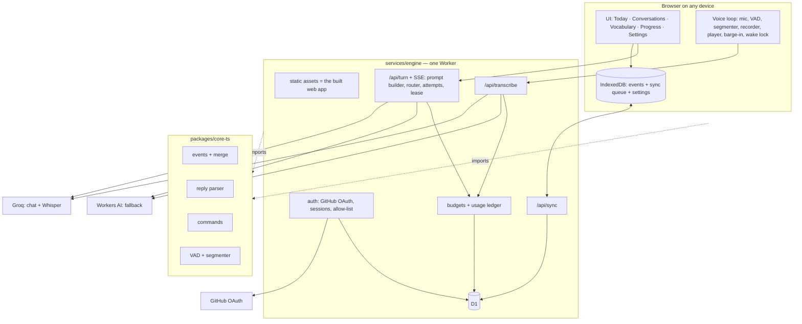

# Lingo Web + Lingo Engine — architecture and code guide (all devices)

Status: **target, accepted direction; code not written yet** · Version 1 · Date: 2026-10-28
Part of the documentation set: [ARCHITECTURE.md](ARCHITECTURE.md) (whole system, shared rules) · [MAC.md](MAC.md) (Lingo for Mac) ·
**WEB.md** (this file) · [CODEBASE.md](CODEBASE.md) (repository map) · [EVOLVING.md](../process/EVOLVING.md) (how to change things).
Requirements: [LINGO-03 spec](../changes/LINGO-03/spec.md) (WR-01…WR-29, WAC-01…WAC-14). Decisions: ADR-0002 (stack), ADR-0003
(sign-in), ADR-0004 (layout and contracts), ADR-0005 (routing and quota).

Read this file before touching `apps/web/`, `services/engine/` or `packages/core-ts/`. Everything below that is marked *planned*
must be created exactly at the given path. When you add, move or delete a module, update this file in the same PR.

---

## 1. What it is

Lingo for **every device that is not the Mac**: iPhone Air, iPhone 11, iPad, Android, Windows and other people's computers.
Two deployable parts and one shared package:

| Part | Path | Runs on | Responsibility | Not responsible for |
|---|---|---|---|---|
| **Lingo Web** | `apps/web` *(planned, P-15…P-18)* | any browser; installable PWA | UI, microphone, utterance detection, recording, playback with device voices, local history copy (IndexedDB), sync queue | prompts, model calls, keys, budgets |
| **Lingo Engine** | `services/engine` *(planned, P-08, P-12…P-14)* | one Cloudflare Worker + one D1 database (free plan) | GitHub sign-in, account history and sync, prompt building, model routing and quota, transcription proxy, usage ledger; later the teacher (LINGO-05) | storing audio; anything the Mac does locally |
| **core-ts** | `packages/core-ts` *(planned, P-07)* | imported by web and engine | TypeScript ports of shared logic: events + merge, ULID, reply-protocol parser, command detector, VAD + segmenter | UI, I/O |

The look is already designed (LINGO-07): reference images in `design/redesign-2026/02-iphone`, `03-ipad`, `05-web-desktop`,
`06-android-windows` (and `07-teacher` for LINGO-05). Values come only from `DESIGN.md` §9 "Web adaptation" — never from pixels.

## 2. Status and order of work

| Step | What | Stage |
|---|---|---|
| P-07 | npm workspaces, `packages/core-ts` with parity tests | Stage 1 |
| P-08 | engine skeleton: Worker, D1 migration 0001, GitHub OAuth, sessions, `/api/me` (needs owner checkpoint H-2) | Stage 1 |
| P-09 | voice spike page + `/api/transcribe` on `*.workers.dev`; device tests at H-3 | Stage 1 |
| P-10, P-11 | model comparison (night), day-plan calibration | Stage 1 |
| P-12 | sync API, idempotency, cursor, storage hygiene | Stage 2 |
| P-13 | turn API: prompts, routing, SSE, attempts, lease, budgets | Stage 2 |
| P-14 | transcription hardening | Stage 2 |
| P-15…P-18 | web shell, voice loop, behaviour, settings/privacy/export | Stage 2 |
| P-19, P-20 | CI completion, production deploy, report (H-4 full-day test, H-5 acceptance) | Stage 2 |

Start prompts: [`docs/process/STAGE-PROMPTS.md`](../process/STAGE-PROMPTS.md) (prompts 3 and 4).

## 3. Containers



## 4. Planned code layout (create exactly here)

```
package.json                     npm workspaces: packages/*, services/*, apps/*
packages/core-ts/src/
  events/        types from packages/contracts/events, ulid.ts, merge.ts (reducer + LWW)
  protocol/      reply-stream parser (@say/@fix/@hint/@heard)
  commands/      command detector (same vocabularies as Swift)
  voice/         vad.ts, segmenter.ts
  test/          parity tests against packages/contracts/fixtures
services/engine/
  wrangler.jsonc                 Worker + static assets + D1 binding + Workers AI binding
  migrations/0001_init.sql …     D1 schema (§6); never edit an applied migration
  src/index.ts                   router, static assets, origin checks, size limits
  src/auth/                      /auth/login, /auth/callback, /auth/logout, sessions, allow-list
  src/sync/                      /api/sync
  src/turn/                      prompt builder (snapshot-identical with Swift), router + pools, SSE, attempts, lease, cancel, status
  src/transcribe/                /api/transcribe → Groq Whisper, Workers AI fallback
  src/ledger/                    budgets, usage ledger, /api/budget
  src/data/                      /api/export, DELETE /api/account/data
  test/                          vitest-pool-workers suites with a local D1 and mocked providers
apps/web/
  vite.config.ts, public/manifest.webmanifest, service worker
  src/app/       routes, layouts (phone: four bottom tabs; wide: sidebar + three columns), i18n ru/en
  src/features/  today, conversations, vocabulary, progress, settings, onboarding, resources
  src/voice/     mic (getUserMedia), recorder (MediaRecorder), player (speechSynthesis), barge-in, wake lock, metrics
  src/store/     IndexedDB events, sync queue, settings
  src/api/       typed client generated from packages/contracts/api/openapi.yaml
  src/design/    tokens generated from DESIGN.md
  e2e/           Playwright flows
```

## 5. API (contract: `packages/contracts/api/openapi.yaml`)

| Endpoint | Purpose |
|---|---|
| `GET /auth/login`, `GET /auth/callback`, `POST /auth/logout` | GitHub sign-in (signed `state`, allow-list by numeric GitHub id), sign-out |
| `GET /api/me` | current account and device |
| `POST /api/sync` | push own events, pull other devices' events after the cursor (batches ≤ 500, idempotent) |
| `POST /api/lease` | one active turn per session across devices (60 s) |
| `POST /api/transcribe` | one utterance → text + language (Groq Whisper, fallback Workers AI) |
| `POST /api/turn` | assistant reply as SSE (`delta`, `sentence`, `segment`, `usage`, `done`) — structured input only |
| `POST /api/turn/{turn}/cancel` · `GET /api/turn/{turn}` | barge-in / stop · reconcile after a dropped stream |
| `GET /api/budget` | today's plan and usage per pool (Resources screen) |
| `GET /api/export` · `DELETE /api/account/data` | full export (JSON Lines, schema v1) · delete all account data |

Change the contract first, then the engine, then the client — in one PR.

## 6. Data

- **Events:** the same journal schema v1 as the Mac (`packages/contracts/events/event.schema.json`, ARCHITECTURE §6.1).
  The TypeScript reducer must reproduce `packages/contracts/fixtures/events/merge-two-devices.expected.json`.
- **D1 tables:** `accounts`, `auth_sessions`, `devices`, `events` (per-account `server_seq` cursor, unique (account, id)), `turns`,
  `attempts` (`reserved → in_flight → completed | failed | cancelled | uncertain`), `leases`, `budgets` — details in ARCHITECTURE §6.2.
- **Free-plan limits:** 500 MB per database, 100 k rows written / 5 M read per day, 100 k requests per day, 10 ms CPU per request.
  Sync is event-driven (open, visibility, after a turn, every 30 s while visible). Archive before 400 MB.
- **Browser:** IndexedDB copy; `navigator.storage.persist()`; storage can be evicted (Safari) — the engine copy and export are the backup.
- **Never stored:** audio (forwarded to Groq for recognition, then dropped), keys outside Worker secrets, utterance text in logs.

## 7. The web voice turn

1. VAD + segmenter close the utterance (pause T or button); the client creates `turn_id` and a pending user message.
2. `POST /api/transcribe` → text; the client writes `message.created` (user) and queues sync.
3. `POST /api/turn` → SSE; finished sentences are spoken at once with `speechSynthesis`.
4. Barge-in: `speechSynthesis.cancel()`, abort the stream, `POST /api/turn/{turn}/cancel`, mark the reply interrupted at the character
   position, ignore late fragments of the old `turn_id`.
5. The engine settles the budget with actual usage; unknown usage is never recorded as zero.

Device limits that shape the design (verify at H-3): iOS Safari needs a user gesture for audio, mic and synthesis share one session,
voices differ per device, the screen must stay awake (Wake Lock); the locked-screen case is LINGO-06 (native iPhone).
Latency target: median `speech_end → audible_start` ≤ 4 s (ceiling 8 s, p90 10 s).

## 8. Security

GitHub OAuth with an allow-list by numeric id; 256-bit session token stored hashed with a pepper; cookie `HttpOnly; Secure; SameSite=Lax`,
30-day sliding expiry; `Origin` check on every state-changing request; every query scoped by account id. Groq keys, the GitHub client
secret and the pepper are Worker secrets entered by the owner (`wrangler secret put`); CI scans the built bundle for key patterns.
Logs: request id, status, latency, pool, model, account id — never utterance text, audio or keys.

## 9. Build, run, test, deploy

| Command | What |
|---|---|
| `npm ci && npm test` | all TypeScript workspaces (Vitest; engine tests in the Workers runtime with a local D1) |
| `npm run dev -w apps/web` + `npx wrangler dev` (in `services/engine`) | local site + engine with local D1 and test secrets |
| `npx playwright test` (in `apps/web`) | UI flows; screenshots 390×844, 820×1180, 1280×800 × light/dark × RU/EN |
| `npx wrangler d1 migrations apply lingo --remote && npx wrangler deploy` | production — **owner only**, per [RELEASE.md](../process/RELEASE.md) |

CI: `.github/workflows/ci-ts.yml` (Linux). Real provider calls in tests are mocked; single real requests only by day, evals only at night.

## 10. Where to change what (web and engine)

| I want to … | Change | Also update |
|---|---|---|
| add an API endpoint | `openapi.yaml` → `services/engine/src/<area>` → `apps/web/src/api` | engine tests, §5 of this file |
| change the D1 schema | new `services/engine/migrations/NNNN_*.sql` | ARCHITECTURE §6.2, RELEASE.md, a migration test |
| change model instructions | the engine prompt builder **and** Swift `PromptBuilder` | snapshots in `packages/contracts/prompts` (byte-identical), night eval |
| change routing, pools or budgets | `services/engine/src/turn`, `src/ledger` | ADR-0005, capacity table in the change's handoff |
| add an event type | contracts schema + fixtures → `core-ts/events` → Swift `Journal` | ARCHITECTURE §6.1, parity tests |
| add a voice command | `core-ts/commands` **and** Swift `CommandDetector` | `commands` eval ≥ 95 % on both |
| add a screen | `apps/web/src/features/<name>` with tokens from `src/design` | reference image, Playwright screenshot, i18n ru/en |
| change a colour, size or font | `DESIGN.md` first → regenerate `src/design` | screenshots |
| add a UI string | i18n key in code; Russian and English in the i18n files | missing-translation check |
| add a dependency | ADR-0002 allow-list first | `package.json` |
| teacher features (LINGO-05) | engine `src/teacher/*` (new), web `features/today`, `progress`, `vocabulary` | LINGO-05 spec, contracts |
