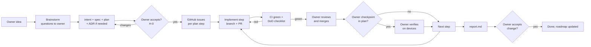

# Lingo — software development lifecycle (SDLC)

How work moves from an idea to an accepted result. Applies to every agent (Claude Code, Codex, others) and every human contributor.
The owner is **itmax04**; the executor is whoever implements a change.

## 1. Roles

| Role | Who | Decides | Does not |
|---|---|---|---|
| **Owner** | itmax04 | goals, scope, priorities, acceptance, merging pull requests into `main`, anything involving accounts, keys, money, devices, system settings | write code |
| **Executor** | an AI agent or a human | how to implement within the accepted spec; records "executor decisions" in `handoff.md` | change scope or rules on its own; merge into `main` without the owner; enter credentials; spend money |
| **Reviewer** | CI + the owner (optionally a second agent) | whether a PR meets the Definition of Done | — |

Communication with the owner is **in Russian**, short: what was done, what the owner must check, what comes next. Everything in the repository is **in English**.

## 2. Artefacts of a change

Every piece of work is a **change** `LINGO-NN` with a folder `docs/changes/LINGO-NN/`:

| File | Content | Who writes | Status flow |
|---|---|---|---|
| `intent.md` | problem, desired outcome, scope / out of scope, constraints, owner decisions, assumptions | executor from the owner's words | draft → accepted |
| `spec.md` | scenarios, numbered requirements, threat model, acceptance criteria — **the only place requirements live** | executor | draft → accepted |
| `plan.md` | steps `P-xx` with requirement ids, owner checkpoints `H-x`, risks, order | executor | draft → accepted |
| `handoff.md` | running log: done, PRs, checks with real output, executor decisions `D-xx`, next step | executor, after every step | living |
| `report.md` | evidence for each acceptance criterion, what is unverified | executor at the end | final |
| `evidence/` | screenshots, metric exports, logs without secrets | executor | — |

Architecture-level decisions go to `docs/decisions/ADR-NNNN-*.md`; system structure to `docs/architecture/ARCHITECTURE.md`; contracts to `packages/contracts/`.

## 3. Lifecycle



1. **Brainstorm.** Before writing documents the executor asks the owner every question whose answer changes scope, cost, risk or UX (multiple choice with a recommended option). Decisions are recorded (translated) in `intent.md`.
2. **Documents.** intent → spec → plan (+ ADR). Requirements have ids; plan steps reference them.
3. **Acceptance of documents (H-0).** No code before the owner accepts.
4. **Issues.** Each plan step becomes a GitHub issue with the step id in the title (`[LINGO-03 P-05] …`), the milestone of its stage, area labels, requirement ids and a Definition of Done checklist.
5. **Implementation.** One issue → one branch → one PR (small steps may be grouped if they touch the same files).
6. **Verification.** CI must be green and the DoD checklist complete. The owner reviews and merges. Owner checkpoints happen where the plan says.
7. **Report and acceptance.** `report.md` with evidence for every acceptance criterion; the owner accepts or returns.

## 4. Autonomy within a stage

The owner chose **"a whole stage at a time"** (2026-10-26):
- The executor works through the issues of the current milestone without asking for permission per step: branches, commits, tests, pull requests, `handoff.md` updates.
- **Merging into `main` is the owner's action.** While a PR waits, the executor may continue with the next issue on a branch based on the previous one (stacked PRs) and rebase after the merge. The executor merges only if the owner explicitly says so in the conversation for that PR or stage.
- The executor stops and asks the owner at **owner checkpoints** (`H-x` in the plan), on a **blocker** only the owner can resolve (accounts, keys, money, devices, a scope conflict), or when a requirement turns out to be wrong.
- At the end of a stage: a short Russian summary (format in §10) with links to the PRs.
- Never: force-push, history rewrite, deleting branches, merging a red PR.

## 5. Definition of Ready (an issue can be started when)
- it references accepted requirement ids or an owner request;
- acceptance criteria are testable;
- dependencies (other issues, owner checkpoints) are done or explicitly not needed;
- no open question would change the implementation.

## 6. Definition of Done (a PR is ready for the owner when)
- [ ] the change does what the issue says; scope did not grow silently;
- [ ] tests added/updated; `swift test` (Mac) and/or `npm test` (TS) pass locally and in CI;
- [ ] contract fixtures updated in the same PR if shared behaviour changed (Swift and TS both pass);
- [ ] `scripts/secret-scan.sh` = 0 findings; no keys, personal data or audio in the diff;
- [ ] `scripts/check-english.sh` passes (repository language policy);
- [ ] docs updated: `handoff.md` (step, checks with real output, decisions), and ARCHITECTURE/ADR/contracts if structure changed;
- [ ] no new dependency outside the ADR allow-lists;
- [ ] UI changes: screenshot(s) in the PR, DESIGN.md tokens only, Russian and English strings present;
- [ ] free-tier impact considered (requests, tokens, D1 writes) and stated in the PR if non-trivial;
- [ ] PR description follows the template.

## 7. Git and GitHub workflow
- `main` is the default and always-green branch. Work happens on `<type>/<issue>-<slug>` branches, e.g. `feat/12-engine-sync`, `fix/30-voice-restart`, `docs/5-adr-auth`.
- Several agents in parallel: each uses its own **git worktree** (`git worktree add ../lingo-<issue> -b <branch>`), never the same working directory.
- Commits: imperative English subject ≤ 72 chars, body with the why; reference the issue (`Refs #12`; `Closes #12` in the PR).
- PRs: one concern, ≤ ~600 changed lines where possible, template filled, linked issue, green CI. The owner squash-merges.
- Labels: `area:mac`, `area:web`, `area:engine`, `area:contracts`, `area:docs`, `area:ci`; `type:feature`, `type:bug`, `type:chore`, `type:test`, `type:docs`; `owner-checkpoint`, `blocked`.
- Milestones = stages of the current change (e.g. "LINGO-03 · Stage 0 — Stabilise").

## 8. Rules that are never relaxed
1. **$0.** No paid APIs, plans, subscriptions or anything that needs a card.
2. **Secrets.** Keys, tokens, passwords, Apple ID, personal data never in code, logs, tests, commits, issues, PRs or chat. Never ask the owner to paste a secret into chat; the owner enters secrets in the app's settings, the Keychain or `wrangler secret put`.
3. **Owner's systems.** No changes to macOS settings, TCC permissions, Keychain trust, GitHub account settings, the Cloudflare dashboard or provider consoles — give the owner exact steps instead.
4. **Accounts.** Agents never create accounts, keys or OAuth apps; the owner does.
5. **Quota.** Dialogue evals and other bulk model calls run only at night (23:00–08:00 Europe/Berlin) in budgeted batches; daytime: single requests only.
6. **Truthful results.** PASS / FAIL / NOT RUN with the real output; a simulator or one successful request is not device evidence.
7. **No pronunciation assessment** in any form.
8. **Models** downloaded only from official sources with a SHA256 check.

## 9. Owner checkpoints (generic list; each plan names its own)
| Kind | Example |
|---|---|
| Acceptance of documents | H-0 of every change |
| Accounts and secrets | `wrangler login`, GitHub OAuth App, `wrangler secret put GROQ_KEY_…` |
| Devices | voice tests on iPhone Air / iPhone 11 / iPad / Android / Windows |
| Live use | 30-minute session, full day 4 × 30 |
| Merges | reviewing and merging PRs into `main` |
| Acceptance of the change | report review |

## 10. Reporting format (to the owner, in Russian)
```
Этап <N> «<название>» — готово / заблокировано
Сделано: <3–6 пунктов>  ·  PR: #…, #…
Проверки: тесты <n> ✔, CI ✔, <evals / устройства>
Тебе: <что проверить, слить или сделать — по шагам>
Дальше: <следующий этап или вопрос>
```
